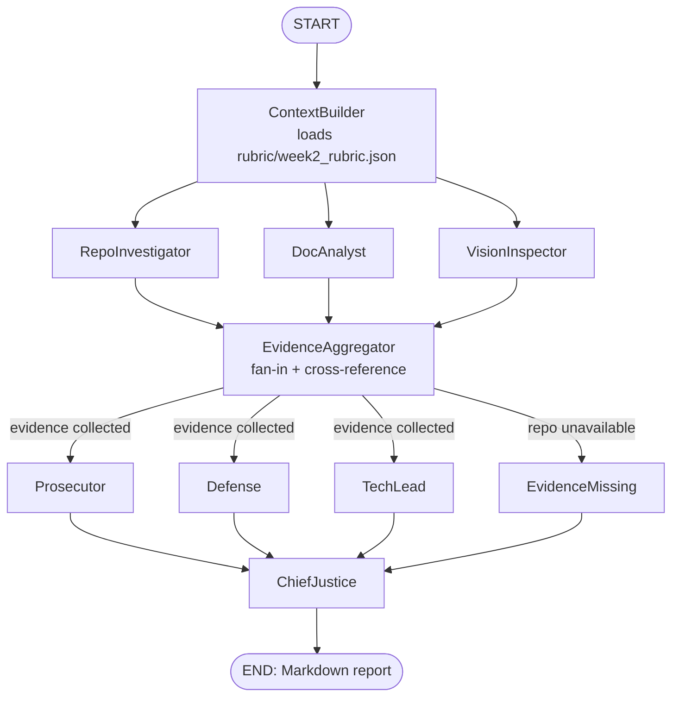

# The Automaton Auditor 🏛️🤖

> **Orchestrating Deep LangGraph Swarms for Autonomous Governance**

The **Automaton Auditor** is a multi-agent governance system that evaluates a code repository and its architectural report (PDF or Markdown) against a machine-readable rubric. Rather than a single-prompt wrapper, it runs as a **Digital Courtroom**: a hierarchical LangGraph `StateGraph` in which Detectives collect facts, three Judges argue over them in parallel, and a Chief Justice resolves the conflict with deterministic rules.

---

## 🏗️ System Architecture

Two parallel fan-out / fan-in stages, a rubric-driven entry node, and a conditional failure route:



| Layer | Node(s) | File | What it does |
|---|---|---|---|
| 0 | `ContextBuilder` | `src/nodes/detectives.py` | Loads the Constitution, validates each dimension's `target_artifact`, dispatches `forensic_instruction`s to detectives, `judicial_logic` to judges and `synthesis_rules` to the Chief Justice. |
| 1 | `RepoInvestigator`, `DocAnalyst`, `VisionInspector` | `src/nodes/detectives.py`, `src/tools/` | Collect facts only (`Evidence` objects with verified `gaps`). Run in parallel. |
| 1 | `EvidenceAggregator` | `src/nodes/detectives.py` | Join node (`add_edge([...], "EvidenceAggregator")`): waits for all detectives, then cross-references the report's claims against the RepoInvestigator's file manifest. |
| 2 | `Prosecutor`, `Defense`, `TechLead` | `src/nodes/judges.py` | Judge the same evidence per criterion, dispatched together by a list-returning conditional edge. |
| 3 | `ChiefJustice` | `src/nodes/justice.py` | Deterministic synthesis + Markdown report. |

State (`src/state.py`) is a `TypedDict` whose parallel-written keys carry reducers: `evidences` (`operator.ior`), `opinions` and `errors` (`operator.add`). `Evidence`, `JudicialOpinion`, `ReportClaims`, `CriterionResult` and `AuditReport` are Pydantic models.

---

## 🔎 The Detective Layer

**RepoInvestigator** (`src/tools/repo_tools.py`). The audited code is parsed with `ast`, never imported or executed.

- `clone_repo_sandboxed`: clones into `tempfile.TemporaryDirectory()` with list-form `subprocess.run`, a `--` separator, URL validation (blocks `--upload-pack=` option injection and `ext::` transports), `GIT_TERMINAL_PROMPT=0` so private repos fail fast instead of hanging, symlinks checked out as plain files, full history and a timeout.
- `extract_git_history`: `git log --reverse` with author timestamps. Flags single-commit, clustered-timestamp and monolithic-first-commit uploads and checks the Setup → Tools → Graph progression.
- `analyze_state_management`: resolves `Annotated[..., reducer]` metadata and transitive `BaseModel` / `TypedDict` inheritance.
- `analyze_graph_structure`: reconstructs the node/edge graph from `add_node` / `add_edge` / `add_conditional_edges`, including join edges, loops over node lists, list-returning routers and `Send`. It then verifies detective and judge fan-out, the evidence fan-in, and a conditional failure route. A purely linear graph is reported as **Orchestration Fraud**; keywords alone earn nothing.
- `analyze_safe_tool_engineering`: finds the function that actually executes `git clone` and checks sandboxing, error handling, captured output, timeout and sanitization. Flags `os.system` / `shell=True`, resolving import aliases.
- `analyze_structured_output`, `analyze_judicial_nuance`, `analyze_chief_justice_node`: schema-bound structured output and retry loops; persona prompt similarity (**Persona Collusion** above 90%) and rubric injection; named deterministic rules (resolving constants such as `SECURITY_CAP = 3`).

**DocAnalyst** (`src/tools/doc_tools.py`) uses a RAG-lite approach:

- `ingest_pdf(path)` parses a PDF (PyMuPDF, with headings detected by font size) or Markdown into section-aware chunks.
- `query_report(path, "What does the report say about Dialectical Synthesis?")` returns the top BM25-ranked chunks.
- `search_theoretical_depth` separates concepts explained next to concrete implementation anchors from **Keyword Dropping**.
- `extract_report_claims` and `cross_reference_report_accuracy` produce Verified vs **Hallucinated Paths**, and check feature claims (e.g. "parallel judges") against the code detective's evidence.

**VisionInspector**: `extract_images_from_pdf` and `classify_diagram_with_vision` (GPT-4o / Gemini, optional). Mermaid diagrams in the report are parsed structurally to check for parallel detective and judge branches.

## ⚖️ The Judicial Layer

- Each persona's system prompt combines its philosophy and the Protocol B statutes with the criterion's `judicial_logic` for that persona, loaded from the rubric.
- LLM calls use `.with_structured_output(JudicialOpinion)`. Free text or schema violations are fed back to the model and retried up to 3 times, and the judge / criterion identity is enforced.
- With no API key (or after exhausted retries), a deterministic persona lens scores the same verified gaps. The Prosecutor charges each gap, the Defense credits strengths, and the Tech Lead gives 1/3/5, so the bench still genuinely disagrees.

## 🏛️ The Supreme Court

`chief_justice_node` applies named, hardcoded rules (no averaging, no LLM):

1. **Rule of Security**: a confirmed `os.system` / `shell=True` flaw overrules Defense effort, caps the criterion at 3 and caps the **overall** score at 3.
2. **Rule of Evidence / Fact Supremacy**: the Defense is overruled when evidence shows the artifact is missing (or no report exists). Unmet requirements are capped at 3.
3. **Variance re-evaluation**: if the surviving judges differ by more than 2, the evidence is re-examined. A complete record overrules the low scorer, an unmet requirement overrules the high scorer, and otherwise the Tech Lead decides.
4. **Rule of Functionality**: the Tech Lead's score carries the architecture criterion.
5. **Statutes**: Orchestration Fraud → 1; Hallucination Liability / Persona Collusion → max 2.

The report follows **Executive Summary → Criterion Breakdown → Remediation Plan**. Each criterion includes the dissent (why the Prosecutor and Defense disagreed and who was overruled) and file-level remediation.

---

## ⚡ Quickstart & Usage

### 1. Environment Setup

```bash
uv sync --extra dev        # creates .venv from the locked dependencies
cp .env.example .env       # never commit .env
```

### 2. Configure API Keys (optional)

```env
OPENAI_API_KEY="..."        # or GEMINI_API_KEY; without either, judges use the deterministic lens
LANGCHAIN_TRACING_V2=true   # LangSmith observability
LANGCHAIN_API_KEY="..."
LANGCHAIN_PROJECT="automaton-auditor"
```

### 3. Run the Auditor

```bash
# Self-audit -> audit/report_onself_generated/audit_report.md
uv run python main.py --repo . --pdf reports/final_report.pdf

# Audit a peer -> audit/report_onpeer_generated/audit_report.md
uv run python main.py --repo https://github.com/<peer>/<repo> --pdf path/to/peer_report.pdf --peer
```

`--pdf` also accepts a Markdown report. When omitted, it defaults to the first existing file among `reports/final_report.pdf`, `reports/interim_report.pdf` and `reports/interim_report.md`. Every run also writes a reasoning-loop trace (every node's state update plus each criterion's three opinions, the rules applied and the dissent) to `audit/langsmith_logs/`. When LangSmith tracing is enabled, the trace link is printed and recorded in that file.

### Docker

```bash
docker build -t automaton-auditor .
docker run --rm --env-file .env -v "$PWD/audit:/app/audit" automaton-auditor --repo https://github.com/<user>/<repo> --pdf reports/interim_report.md
```

---

## 📜 The Constitution

`rubric/week2_rubric.json` defines 10 dimensions. Each has a `target_artifact` (`github_repo`, `pdf_report` or `pdf_images`), a `forensic_instruction`, success and failure patterns, per-persona `judicial_logic` and a file-level `remediation`, plus global `synthesis_rules`. Editing the JSON changes detective dispatch, judge prompts and the Chief Justice's cited rules without code changes.

## 📁 Deliverables Layout

| Path | Contents |
|---|---|
| `audit/report_onself_generated/` | This auditor run against this repository |
| `audit/report_onpeer_generated/` | This auditor run against the assigned peer's repository (`--peer`) |
| `audit/report_bypeer_received/` | The report a peer's auditor produced about this repository |
| `audit/langsmith_logs/` | Reasoning-loop trace exports / LangSmith links |
| `reports/` | Architecture reports (interim / final) |

## 🧪 Running Tests

```bash
uv run pytest -q
```

Tests never call live LLMs: `tests/conftest.py` strips API keys so the deterministic paths are exercised.

---

## 📄 License
MIT License
