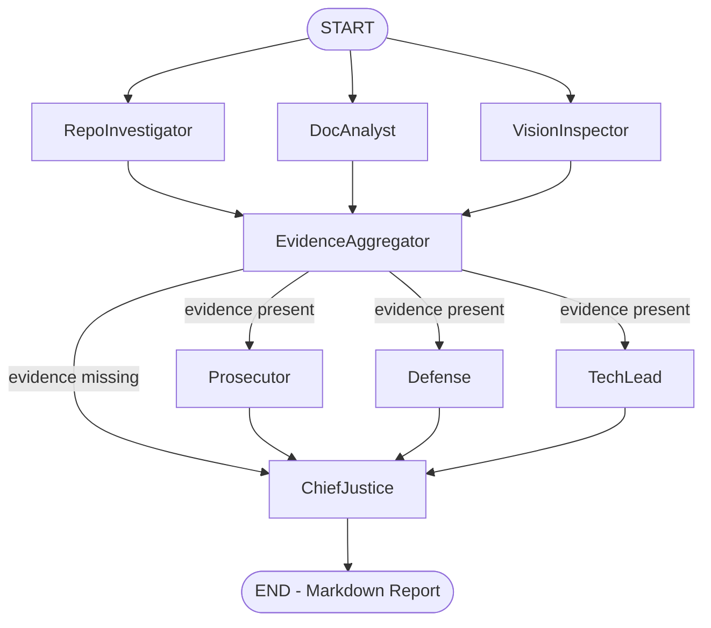

# The Automaton Auditor — Interim Architecture Report

> **Note:** This document is Markdown source. Convert to PDF (e.g. `pandoc reports/interim_report.md -o reports/interim_report.pdf`,
> or print-to-PDF) before submission, per the assignment's PDF report requirement.

## 1. Architecture Decisions Made So Far

### Why Pydantic / TypedDict over plain dicts

`src/state.py` defines four Pydantic `BaseModel` classes (`Evidence`, `JudicialOpinion`,
`CriterionResult`, `AuditReport`) plus a `TypedDict`-based `AgentState`. Plain dicts were rejected
for two reasons specific to this system:

1. **Cross-node contracts.** Detectives, Judges, and the Chief Justice are separate LangGraph
   nodes written independently of each other. A typed `Evidence` object (with `goal`, `found`,
   `content`, `location`, `rationale`, `confidence` fields) is a contract every downstream node can
   rely on without re-parsing free text. A dict soup would let a Detective silently omit a field a
   Judge depends on, and the failure would only surface at runtime deep in a prompt.
2. **Structured LLM output enforcement.** `JudicialOpinion` is passed directly to
   `.with_structured_output(JudicialOpinion)` when querying Judge LLMs (`src/nodes/judges.py`).
   This is what the rubric's `structured_output_enforcement` dimension explicitly checks for —
   the schema *is* the parser, so a malformed LLM response fails validation immediately rather
   than being silently accepted as a score.

`AgentState.evidences` and `AgentState.opinions` use `Annotated` reducers
(`operator.ior` for the evidence dict, `operator.add` for the opinions list). Since
`RepoInvestigator`, `DocAnalyst`, and `VisionInspector` all fan out from `START` and write to
`evidences` concurrently, and `Prosecutor`/`Defense`/`TechLead` all fan out from
`EvidenceAggregator` and write to `opinions` concurrently, LangGraph needs a merge strategy or
the last node to finish would clobber the others' writes. `operator.ior` merges dict keys
(each detective owns a distinct key: `github_repo`, `pdf_report`, `pdf_images`);
`operator.add` concatenates opinion lists (each judge appends its own list of 10 opinions).

### How AST parsing was structured

`src/tools/repo_tools.py` implements two `ast.NodeVisitor` subclasses instead of regex, per the
rubric's explicit instruction ("Use AST parsing, not regex"):

- **`StateASTVisitor`** walks `ClassDef` nodes, checking base classes for `BaseModel` /
  `TypedDict`, and specifically inspects any class named `AgentState`/`State` for mentions of
  `Evidence`, `JudicialOpinion`, and the reducer functions (`operator.add`, `operator.ior`) in its
  unparsed source. This directly implements the `state_management_rigor` forensic protocol.
- **`GraphASTVisitor`** walks `Call` nodes, detecting `StateGraph(...)` instantiation and
  collecting every `add_edge()` / `add_conditional_edges()` call as unparsed source text. The
  surrounding `analyze_graph_orchestration()` function combines this with a keyword scan (does
  the file reference all three Detectives *and* all three Judges *and* an aggregator node) to
  decide whether the graph is a real fan-out/fan-in swarm or a linear chain in disguise. AST
  parsing catches structural intent (e.g. an actual `add_edge` call) that a naive string search for
  `"StateGraph"` would miss or be fooled by (a commented-out reference would still match a regex).

### Sandboxing strategy

`clone_repo_sandboxed()` in `repo_tools.py` never touches the live working directory. It opens a
`tempfile.TemporaryDirectory()`, clones into it with `subprocess.run(["git", "clone", ...],
capture_output=True, timeout=60, check=False)`, and returns the directory object to the caller so
it can be explicitly `.cleanup()`-ed in a `finally` block once forensic analysis finishes. Two
things were deliberate:

- **No `os.system()`.** The rubric treats raw `os.system()` calls as a hard security violation
  (`safe_tool_engineering`), since they invite shell injection if a repo URL is ever
  attacker-controlled. `subprocess.run` with a list of args avoids shell interpretation entirely.
- **Graceful failure, not exceptions.** A failed clone (bad URL, auth failure, timeout) returns
  `(None, None, error_message)` rather than raising, so a single bad target repo can't crash the
  whole audit swarm — it just produces an `Evidence(found=False, ...)` object that flows through
  the rest of the graph normally.

The same `analyze_safe_tool_engineering()` function is applied reflexively to any target repo
being audited (including this one), scanning `src/tools/` for `tempfile` usage and flagging raw
`os.system(` calls via regex on the *target's* source — this is intentionally regex, not AST,
since it's a simple substring-style violation check rather than a structural one.

## 2. Planned StateGraph Flow (Detective Fan-Out / Fan-In)

This mirrors the structure actually wired in `src/graph.py::build_auditor_graph()`: two distinct
parallel fan-out/fan-in stages (Detectives → Aggregator, Judges → ChiefJustice) joined by a single
conditional edge (`check_evidence_health`) that routes straight to `ChiefJustice` if evidence
collection failed entirely, rather than running three Judges against nothing.

## 3. Known Gaps and Plan

| Gap | Status | Plan |
|---|---|---|
| VisionInspector real multimodal execution | Implemented (`extract_images_from_pdf`, `classify_diagram_with_vision` in `doc_tools.py`), but unexercised without a configured vision-capable API key | Per the spec, execution is optional — the heuristic (text-proximity) fallback covers the no-key case. Will validate against a real diagram once `GEMINI_API_KEY`/`OPENAI_API_KEY` quota is available. |
| Conditional error-handling edges | Only one conditional edge exists today (`EvidenceAggregator` → Judges vs. `ChiefJustice`) | Add a second conditional edge around `RepoInvestigator` to route clone failures to a dedicated error-report path instead of producing a single low-confidence `Evidence` object. |
| Peer review loop | Not yet started — no peer has been assigned | Once assigned, run this swarm against the peer's repo (`audit/report_onpeer_generated/`) and incorporate the peer's findings about this repo (`audit/report_bypeer_received/`) into the final report's MinMax reflection. |
| Dockerized runtime | Added (`Dockerfile`, git + uv install) | Needs a smoke test running the full swarm inside the container against a real target repo. |

## 4. Judicial Layer (Built Ahead of Schedule)

Although the interim deliverable only requires the Detective layer and `EvidenceAggregator`, this
repository already has `src/nodes/judges.py` (Prosecutor / Defense / TechLead with distinct system
prompts and `.with_structured_output(JudicialOpinion)`) and `src/nodes/justice.py`
(`ChiefJusticeNode` with hardcoded deterministic rules: security override, fact supremacy,
functionality weight, and dissent-on-variance) implemented and unit-tested
(`tests/test_synthesis_rules.py`, `tests/test_end_to_end_graph.py`). The final report will expand
on the dialectical reasoning behind persona design and the specific conflict-resolution logic in
`ChiefJusticeNode`.
